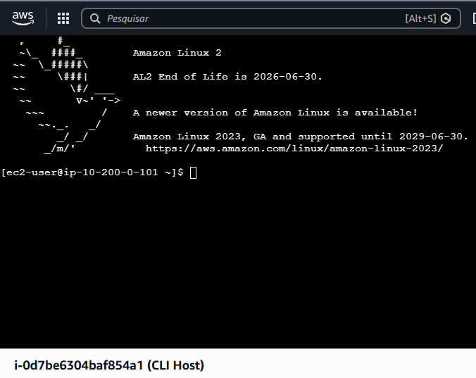
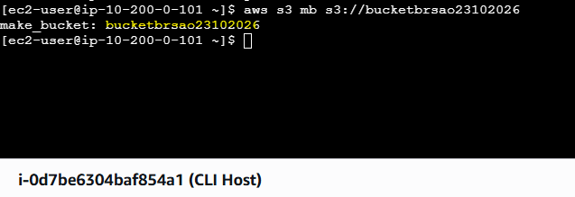
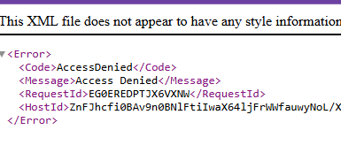
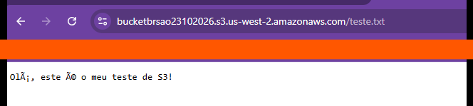
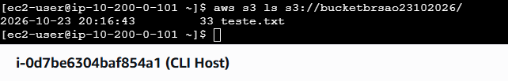

# Lab – AWS CLI e Amazon S3: criação de bucket, upload e controle de acesso a objetos

Laboratório prático da AWS (re/Start – Escola da Nuvem) em que usei a **AWS CLI**, a partir de uma instância EC2, para criar um bucket no **Amazon S3**, enviar um arquivo, comprovar que objetos novos são **privados por padrão**, torná-lo público com uma **ACL** e listar o conteúdo do bucket.

## 🏗️ Componentes

| Componente | Função |
|---|---|
| **CLI Host (EC2)** | Instância Amazon Linux usada como terminal de comando, acessada pelo EC2 Instance Connect |
| **AWS CLI** | Ferramenta de linha de comando para criar e gerenciar os recursos |
| **Bucket Amazon S3** | Armazenamento de objetos criado pela CLI |
| **Objeto `teste.txt`** | Arquivo de texto de teste enviado ao bucket |

## 🎯 Objetivos

- [x] Conectar-se a uma instância EC2 pelo EC2 Instance Connect
- [x] Configurar a AWS CLI com região e formato de saída
- [x] Criar um bucket do S3 pela linha de comando
- [x] Enviar um objeto ao bucket e testar o acesso anônimo, que é negado por padrão
- [x] Tornar o objeto público com `put-object-acl` e acessá-lo pelo navegador
- [x] Listar o conteúdo do bucket com `aws s3 ls`

## 🛠️ Serviços e ferramentas


## 📋 Passo a passo

### Tarefa 1 – Conectar ao CLI Host
No console, em **EC2 → Instâncias**, selecionei o **CLI Host** e conectei pela aba **EC2 Instance Connect**, que abre um terminal no navegador.



### Tarefa 2 – Configurar a AWS CLI
No terminal, executei `aws configure` e informei a Access Key, a Secret Key (valores fornecidos pelo laboratório), a região `us-west-2` e o formato de saída `json`.

```bash
aws configure
```

### Tarefa 3 – S3 e AWS CLI

**3.1 Criar o bucket**
O nome do bucket precisa ser único no mundo todo, com letras minúsculas e números.

```bash
aws s3 mb s3://<NOME_DO_BUCKET>
```

A CLI confirmou a criação com a mensagem `make_bucket`.



**3.2 Enviar um objeto e testar o acesso restrito**
Criei um arquivo de teste, enviei ao bucket e tentei abrir a URL do objeto no navegador.

```bash
echo "Olá, este é o meu teste de S3!" > teste.txt
aws s3 cp teste.txt s3://<NOME_DO_BUCKET>/
```

O navegador retornou **`AccessDenied`**, porque objetos novos no S3 são privados por padrão.



**3.3 Tornar o objeto público**
Alterei a ACL do objeto para leitura pública:

```bash
aws s3api put-object-acl --bucket <NOME_DO_BUCKET> --key teste.txt --acl public-read
```

Depois disso, a mesma URL passou a exibir o conteúdo do arquivo.



> 📝 **Observação sobre os acentos:** no print, o texto aparece como `Olá, este é o meu teste de S3!` em vez de `Olá, este é o meu teste de S3!`. Isso **não é erro no arquivo nem no acesso**: o objeto está em UTF-8 (os 33 bytes mostrados na listagem são compatíveis com esse texto) e foi entregue corretamente, o que comprova que o acesso público funcionou. O que acontece é que o S3 serviu o `.txt` sem informar o charset no cabeçalho `Content-Type`, e o navegador interpretou a codificação errada, um problema clássico de *mojibake*.
>
> Para exibir os acentos corretamente, basta enviar o objeto informando o charset (o `cp` recria o objeto, então a ACL pública também precisa ser informada de novo):
>
> ```bash
> aws s3 cp teste.txt s3://<NOME_DO_BUCKET>/ --content-type "text/plain; charset=utf-8" --acl public-read
> ```

**3.4 Listar o conteúdo do bucket**

```bash
aws s3 ls s3://<NOME_DO_BUCKET>/
```

A listagem mostra o `teste.txt` com 33 bytes e a data de upload.



## ✅ Resultados

- Bucket criado e objeto enviado inteiramente pela AWS CLI
- Comportamento padrão do S3 comprovado: o objeto novo retorna `AccessDenied`
- Acesso público liberado de forma pontual, apenas para um objeto, com ACL
- Conteúdo do bucket listado pela linha de comando

## 📚 Aprendizados

- Objetos novos no S3 são **privados por padrão**, e o acesso anônimo retorna `AccessDenied`
- `aws s3 mb`, `aws s3 cp` e `aws s3 ls` cobrem o ciclo básico de criar, enviar e listar, e `aws s3api` dá acesso às operações de baixo nível, como as ACLs
- Nomes de bucket são globalmente únicos
- Em contas reais, o padrão atual dos buckets é bloquear ACLs e acesso público. Tornar um objeto público deve ser uma exceção consciente
- **Codificação de caracteres:** no print do objeto público, o navegador mostrou `Olá` e `é` no lugar de `Olá` e `é`. O arquivo está em UTF-8 (33 bytes, compatíveis com esse texto), mas o S3 serviu o `.txt` sem informar o charset, e o navegador interpretou a codificação errada. Enviar o objeto com `--content-type "text/plain; charset=utf-8"` resolve
- O terminal mostra o aviso de fim de vida do Amazon Linux 2 (30/06/2026). Em ambientes reais, convém usar Amazon Linux 2023

## ⚠️ Segurança

As credenciais do laboratório (Access Key e Secret Key) não aparecem nos prints nem neste repositório, e a barra de favoritos do navegador foi ocultada.

## 👩‍💻 Autora

**LUCIANA RB DE ASSIS**

[LinkedIn](https://www.linkedin.com/in/lucianarbassis/) · [GitHub](https://github.com/alra-code)
